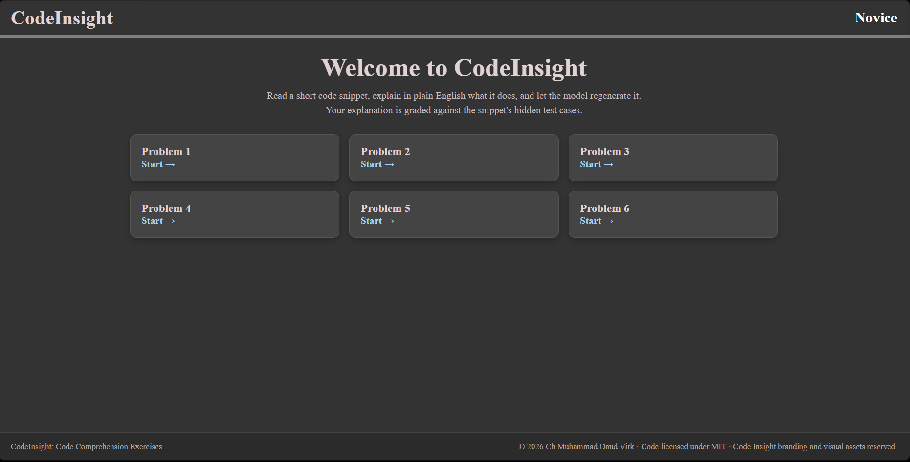
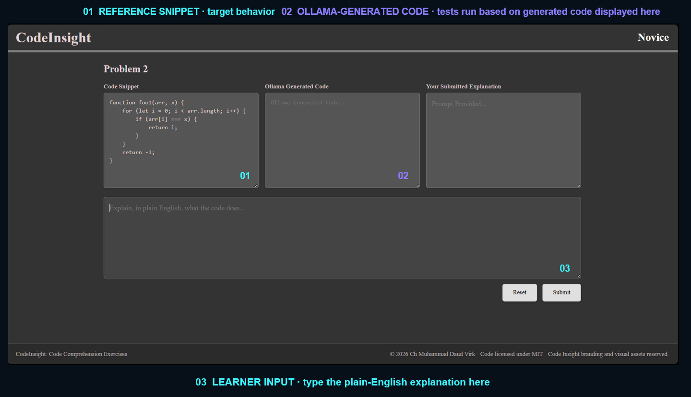
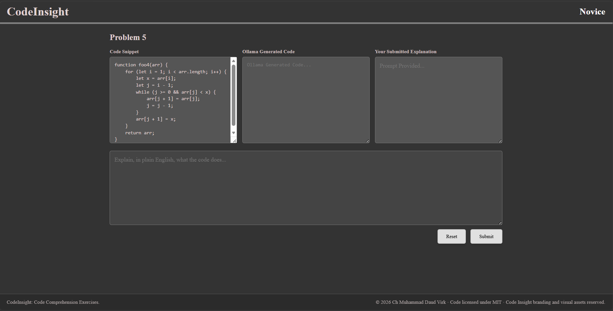

> Last modified: Aug 27th, 2026 - was done to primarily complete the demo section - will update _fully_ when I get to v0.9.0

# CodeInsight

**AI-powered code comprehension exercises for novice programmers.**

> v0.8.0

> Please note that this project is being adapted from 2024 - CPSC 310 - Introduction to Software Engineering. You may find remnants from the long past... 

## Overview

Most introductory programming courses teach students to *write* code - but understanding *existing* code is an equally critical skill that is rarely assessed systematically.

CodeInsight addresses this gap. Students are presented with short, intentionally opaque code snippets (variable names replaced with `foo`, `x`, `arr`) and must explain, in plain English, what the code does. Their explanation is then sent to a locally-hosted LLM (Ollama / DeepSeek-Coder (wip -- am presently looking at qwen2.5)) which regenerates a JavaScript function from that natural-language description. The regenerated function is automatically tested against the snippet's hidden test suite - if all tests pass, the student's comprehension is validated; if tests fail, the specific failing cases are surfaced so the student can refine their understanding.

The result is a tight feedback loop: *read → explain → verify* - with zero reliance on cloud APIs or external accounts, therby maintaining a high degree of privacy.

## Demo

> As mentioned, this is a WIP. As such the demo accurately represents the current state of the repository. 

Below is the Landing Page of the application. It's where you... land.


Below is what a problem page looks like -- this one is labelled so as to help the viewer and direct attention as appropriate. 


Below is a specific problem page rendered to help make the video easier to understand based on how you're viewing this markdown. 


Below is a video _briefly_ illustrating how one would interact with the page. First you should see that the furnished plain English explanation was correct (and the code that was produced by the local LLM was also correct, resulting in all the test cases passing). Then you'll see the English being mutated so as to become incorrect, resulting in test cases failing due to the code being generated not being functionally equivalent to the code that had to be evaluated. 

<video src="./media/ascending_descending.mp4" controls width="100%"></video>

## Key Features

- **Six progressive exercises** - from summing two numbers to insertion sort, each with full-path-coverage test suites
- **Local LLM integration** - Ollama with DeepSeek-Coder runs entirely on the user's machine; no API keys, no data leaving localhost
- **Automated functional-equivalence grading** - generated code is eval'd against hidden tests; pass/fail counts and specific failing cases are shown immediately
- **Multi-page SPA** - React Router v5 with a landing page, per-problem routes (`/problem/1` … `/problem/6`), and a 404 page
- **Responsive dark-mode UI** - CSS grid layout that reflows for mobile; sticky header, problem cards, monospace code panels
- **Dockerized deployment** - single `docker-compose up --build` spins up both the React app and the Ollama container with the model pre-pulled
- **Prompt engineering** - tuned generation parameters (temperature, top_k, top_p) and a structured appendix to maximise valid JavaScript output from the model
- **Regex-based function normalisation** - generated functions are renamed to a canonical `foo` before testing, regardless of whether the LLM uses declarations, expressions, or arrow syntax

## Tech Stack

| Area | Technology |
|------|-----------|
| Front-end framework | React 18 (Create React App) |
| Build tooling | CRACO (webpack override without ejecting) |
| Routing | react-router-dom v5 |
| LLM runtime | Ollama (DeepSeek-Coder) |
| LLM client | `ollama` npm package (browser, via polyfills) |
| Node polyfills | buffer, crypto-browserify, stream-browserify, vm-browserify, process |
| Testing (unit) | Mocha + Chai (browser runner) |
| Testing (smoke) | Jest + React Testing Library |
| Containerisation | Docker + Docker Compose |
| Version control | Git + GitHub (Issues, templates) |

## Architecture

### Architecture - Local

```
┌─────────────────────────────────────────────────────────┐
│  Browser (localhost:3000)                                │
│                                                         │
│  React SPA                                              │
│  ┌──────────┐  ┌────────────┐  ┌────────────────────┐  │
│  │  Home    │→ │ ProblemPage│→ │ ollamaFunctionality│  │
│  │ (cards)  │  │ (per slug) │  │ (prompt + generate)│  │
│  └──────────┘  └────────────┘  └─────────┬──────────┘  │
│                                           │             │
│                                           ▼             │
│                                 ┌──────────────────┐    │
│                                 │ ollamaCodeTester │    │
│                                 │ (eval + tests)   │    │
│                                 └──────────────────┘    │
└───────────────────────────────────┬─────────────────────┘
                                    │ HTTP (generate)
                                    ▼
                          ┌───────────────────┐
                          │  Ollama server    │
                          │  localhost:11434  │
                          │  (deepseek-coder)│
                          └───────────────────┘
```

**How it works locally:**

1. The React development server (`craco start`) serves the SPA on `localhost:3000`.
2. The user navigates to a problem page; the code snippet is rendered from `problemRegistry.js`.
3. On submit, the user's explanation is appended with prompt-engineering instructions and sent via the `ollama` npm client (running *in the browser* thanks to CRACO's Node polyfills) to the Ollama REST API at `localhost:11434`.
4. The LLM's response is parsed - the fenced JavaScript code block is extracted, comments are stripped, and the function name is regex-normalised to `foo`.
5. The normalised function plus the corresponding test-suite string are concatenated and executed with `eval()`. The test suite mutates shared `failureCount` / `failures` variables.
6. Results (pass/fail count, specific failing cases) are rendered back in the UI.

### Architecture - Docker

```
┌────────────────────────────────────────────────────────────────┐
│  Docker Compose network                                        │
│                                                                │
│  ┌──────────────────────┐       ┌───────────────────────────┐  │
│  │  app (CodeInsight)   │       │  ollama                   │  │
│  │  node:20             │       │  ollama/ollama:latest      │  │
│  │                      │       │                           │  │
│  │  craco start         │       │  entrypoint.sh:           │  │
│  │  HOST=0.0.0.0:3000   │       │    ollama serve &         │  │
│  │                      │       │    ollama pull             │  │
│  │  Port: 3000 → host   │       │      deepseek-coder      │  │
│  └──────────────────────┘       │                           │  │
│                                 │  Port: 11434 → host       │  │
│                                 └───────────────────────────┘  │
└────────────────────────────────────────────────────────────────┘
         │                                     │
         ▼                                     ▼
   Host :3000                            Host :11434
   (browser loads SPA)              (browser calls Ollama API)
```

**How it works with Docker:**

1. `docker-compose up --build` starts two containers on a shared network.
2. The **ollama** container runs `entrypoint.sh`, which starts the Ollama daemon, waits for it to initialise, and pulls the `deepseek-coder` model. Port 11434 is mapped to the host.
3. The **app** container installs dependencies, then runs the React dev server bound to `0.0.0.0:3000` (overriding the local-only `127.0.0.1` default). Port 3000 is mapped to the host.
4. The browser loads the SPA from `localhost:3000`. When the user submits an explanation, the browser-side Ollama client sends a request directly to `localhost:11434` on the host - which Docker forwards into the ollama container.
5. Testing and feedback proceed identically to local mode.

> **Note:** The Ollama client in the browser targets `127.0.0.1:11434`. This works because both container ports are mapped to the host, and the browser runs on the host. No inter-container networking is needed for the API calls - they pass through the host's loopback.

## How to Run

### Prerequisites

- **Node.js** ≥ 18 and **npm** ≥ 9
- **Ollama** installed locally (for local mode), or **Docker Desktop** (for Docker mode)
- ~4 GB free RAM (the DeepSeek-Coder model requires memory for inference)

### Running Locally

```bash
# 1. Clone and install
git clone https://github.com/sneaky-gremlin/CodeInsight.git
cd CodeInsight
npm install

# 2. Start Ollama and pull the model (separate terminal)
ollama serve
ollama pull deepseek-coder

# 3. Start the development server
npm start
```

The app opens at **http://127.0.0.1:3000**. Ollama must remain running on port 11434.

> **Tip:** Use `npm run serve` (not bare `serve`) to preview a production build - it binds to `127.0.0.1` rather than exposing to LAN.

### Running with Docker

> **Important:** The `entrypoint.sh` script **must** use LF line endings. The `.gitattributes` file enforces this (`*.sh text eol=lf`), but if your editor converts it to CRLF the ollama container will fail to start. Verify with `file entrypoint.sh` or your IDE's status bar.

```bash
# First time (builds images + pulls model - may take several minutes)
docker-compose up --build

# Subsequent runs (reuses cached images - fast)
docker-compose up

# Tear down containers (images remain for fast rebuild)
docker-compose down
```

Once both containers are healthy, open **http://localhost:3000**.

| Command | When to use |
|---------|-------------|
| `docker-compose up --build` | First run, or after changing Dockerfile / config |
| `docker-compose up` | Quick restart; deps and model are cached |
| `docker-compose down` | Remove containers but keep images |
| `Ctrl+C` | Pause containers (resume with `docker-compose up`) |

## Next Steps

These are / will be documented in GitHub Issues, but key directions _possibly_ include:

- **Sandbox the eval** - replace raw `eval()` with a Web Worker or iframe sandbox to prevent arbitrary code execution
- **User persistence** - integrate JSON Server or a lightweight DB so progress survives page reloads
- **Environment-configurable Ollama host** - support a `REACT_APP_OLLAMA_HOST` variable so the endpoint isn't hardcoded
- **Expand the problem set** - add more snippets with varying difficulty and language constructs
- **Migrate to react-router v6** - v5 is end-of-life
- **Improve test coverage** - expand Jest suite beyond the single smoke test; add integration tests for the Ollama flow with mocks
- and more...

## What I Learned / Technical Highlights

- **Webpack polyfill wrangling** - CRA 5 dropped automatic Node polyfills; configuring CRACO to re-inject `buffer`, `crypto`, `stream`, `vm`, and `process` was essential to run the `ollama` client in the browser without ejecting. This really highlights the importance of understanding minutiae when working with legacy code -- even when the code in question is your own.
- **Prompt engineering for constrained output** - tuning `temperature`, `top_k`, `top_p`, and appending strict instructions ("return JUST a single function codeblock") significantly improved the rate of parseable JavaScript responses. In essence, experiementation with LLMs is important, especially when you can prompt-engineer and adjust parameters.
- **Regex-driven function normalisation** - writing a set of regexes that handle declarations, named/anonymous expressions, arrow functions (block and concise), and reliably rename them to `foo` for testing against a fixed test harness. Consistent application of RegEx is requires more cognitive strain than one might think; this also highlighted the importance of iterations wrt testing as I wouldn't have been able to account for the different types of functions JS can produce unless I repeatedly evaluated LLM output with different prompts. 
- **Docker multi-container orchestration** - understanding the difference between inter-container networking vs. host-mapped ports, and correctly binding a dev server to `0.0.0.0` inside a container while keeping local dev bound to `127.0.0.1`. This really highlights the importance of reading the documentation. 
- **Eval-based test execution** - designing a template-string test harness that mutates shared variables (`failureCount`, `failures`) and surfaces per-case feedback, balancing pedagogical value against the security trade-offs of `eval`. Highlights the importance of security -- also this is a legacy carry forward: had time been permitting I woud have chosen a different approach or been more security-conscious in the first pass. 
- **Full-path-coverage test design** - writing test suites for six functions using cyclomatic complexity analysis to ensure every branch is exercised, including boundary and mutation-resistant cases. Testing is importance, especially when you're testing others. This also means that you have to be mindful of the test cases you yourself right, i.e., you have to ensure that if you're writing tests based on specifications as opposed to code (which is now the norm, given the pervasivenss of LLMs), functional equivalency should be maintained, i.e., two functions that are to the same end should pass the same test suite and should be (almost) identical in cyclomatic complexity analysis. (Omitting nuances here.)

## License

Source code and documentation are licensed under the **MIT License**. See [`LICENSE`](./LICENSE).

The CodeInsight name, logo, screenshots, and visual assets are not licensed for reuse without prior written permission.

---

## Note: Why Create React App (not Vite)

This project uses **Create React App** (CRA) with **CRACO** rather than Vite. The reasons are pragmatic:

1. **Legacy origin** - the project began as a university course deliverable (2024) when CRA was the prescribed toolchain. Migrating mid-development was not feasible.
2. **Node polyfill story** - the `ollama` npm client and the `eval`-based tester depend on Node built-ins (`buffer`, `stream`, `crypto`, `vm`, `process`). CRA's webpack pipeline supports polyfill injection via CRACO's `resolve.fallback` configuration - a well-documented, single-file override. Vite (esbuild/Rollup) requires a different plugin ecosystem (`vite-plugin-node-polyfills`) with less mature edge-case coverage for multiple simultaneous polyfills at the time of initial development.
3. **No eject required** - CRACO wraps `react-scripts` transparently; all standard CRA commands (`start`, `build`, `test`) continue to work. The project retains upgrade-ability and Jest integration without maintaining a custom webpack config.

A Vite migration is feasible and would improve cold-start and HMR speed, but is not a priority given the current feature roadmap.

Small note -- the polyfill issue has a solution: "the ollama package ships a browser-specific entry (ollama/browser) that only needs fetch. If you switched to that import, you could likely drop most of these polyfills." -- will explore later, AFTER v0.9.0 before v1.0.0  
